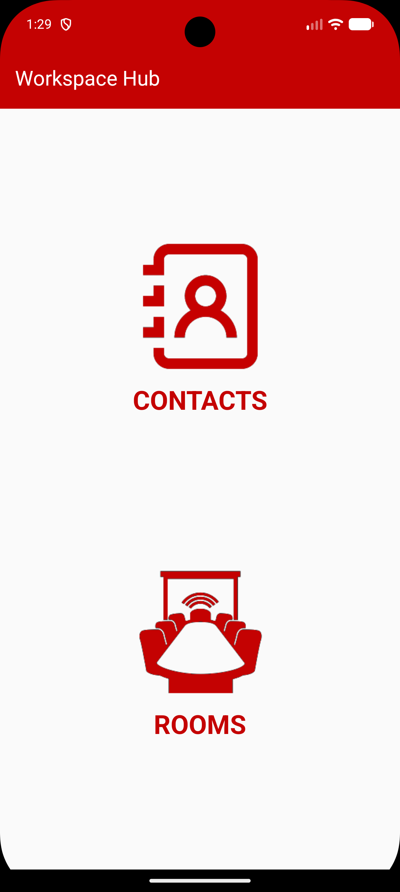
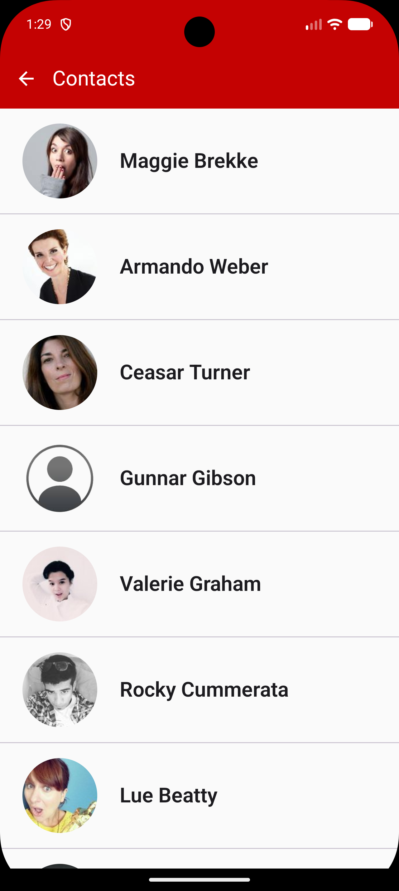
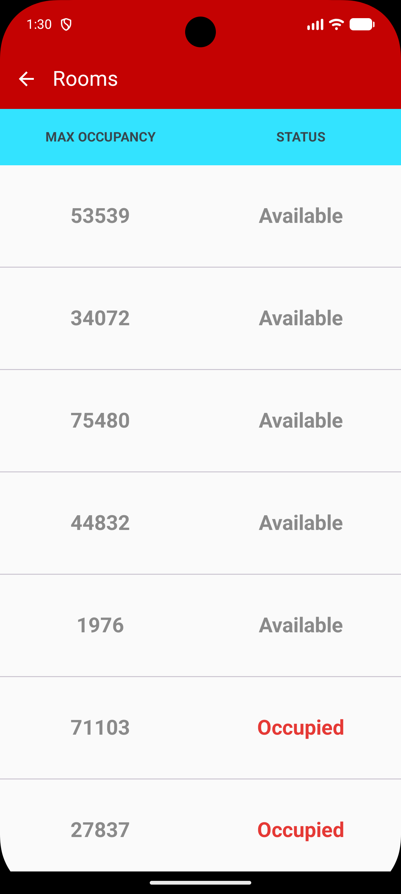

# WorkspaceHub (Jetpack Compose) 🏢

[](https://github.com/syeds-dev/workspace-hub-compose/actions/workflows/android-ci.yml)


A workplace directory app: browse **colleagues** and check **meeting room availability**.

This is a **UI-layer migration** of [WorkspaceHub (XML Views)](https://github.com/syeds-dev/workspace-hub-android) to Jetpack Compose. The **models, repositories, Hilt modules and ViewModels are identical** to the XML version. Only the UI changed, which shows how a clean MVVM architecture lets you replace the view layer without touching business logic.

<p align="center">
  
  &nbsp;
  
  &nbsp;
  
  &nbsp;
  
</p>

## ✨ Features

- **Contacts:** colleagues with profile photos; tap one to see email, job title and favourite colour
- **Rooms:** maximum occupancy and **Available / Occupied** status
- Loading and error states with **Retry**, including the original no-internet check
- Android 12+ **splash screen API** instead of a separate splash activity
- **Accessibility:** the original TalkBack descriptions, plus room rows read as one sentence

## 🔁 What changed, and what didn't

| Layer | XML version | Compose version |
|---|---|---|
| Models (`data/models`) | ✅ | ✅ unchanged |
| API + repositories (`data/`, `repository/`) | ✅ | ✅ unchanged |
| Hilt modules (`di/`) | ✅ | ✅ unchanged |
| `ContactsViewModel`, `RoomsViewModel` | ✅ | ✅ unchanged |
| Unit tests (`test/`) | ✅ | ✅ unchanged |
| Screens | Fragments + XML layouts | Composables |
| Lists | RecyclerView + Adapters | `LazyColumn` |
| Navigation | XML nav graph + Bundles | Navigation Compose |
| Contact details data | Passed field by field in a Bundle | Read from the shared `ContactsViewModel` |
| Images | Glide | Coil |
| Splash | `SplashScreen` activity + 3 s delay | `core-splashscreen` API |
| UI tests | Espresso on Fragments | Compose UI tests |

## 🛠 Tech stack

Kotlin · Jetpack Compose · Material 3 · Navigation Compose · MVVM · Hilt · StateFlow + `collectAsStateWithLifecycle` · Coroutines · Retrofit · Gson · OkHttp · Coil · JUnit · Compose UI Test · GitHub Actions

## 🏗 Architecture

```
Composable Route (stateful)  ──collects──►  ViewModel StateFlow (unchanged)
        │                                         │
        ▼                                         ▼
Composable Screen (stateless)              Repository ──► Retrofit API
```

Each screen has a **stateful `…Route`**, which talks to the ViewModel, and a **stateless `…Screen`**, which only renders a `ContactsEvent` or `RoomsEvent`. That makes the screens previewable and testable without Hilt.

```
ui/
 ├── MainActivity.kt          # Compose host + splash screen
 ├── navigation/              # NavHost and routes
 ├── theme/                   # Colours and Material 3 theme
 ├── components/              # Top bar, loading, error, avatar
 ├── home/HomeScreen.kt
 ├── contactscreen/           # ContactsScreen, ContactDetailsScreen, ContactsViewModel (unchanged)
 └── roomscreen/              # RoomsScreen, RoomsViewModel (unchanged)
```

## 🧪 Testing

```bash
./gradlew testDebugUnitTest          # unit tests (same as XML version)
./gradlew connectedDebugAndroidTest  # Compose UI tests (emulator or device)
```

## 🚀 Getting started

```bash
git clone https://github.com/syeds-dev/workspace-hub-compose.git
```
Open in Android Studio, let Gradle sync, and run on an emulator or device (Android 5.0+).

## 👤 Author

**Syed Subahani**, Senior Android Engineer
[LinkedIn](https://linkedin.com/in/subahani-syed-240bb0112) · [Portfolio](https://syeds.pages.dev) · syeds.androiddev@gmail.com
